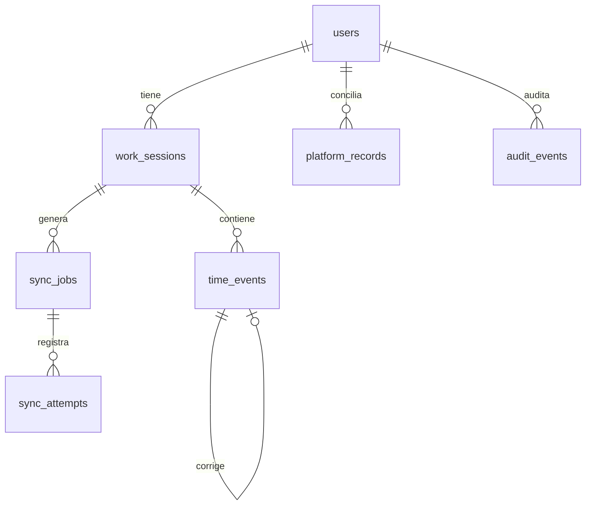

# Modelo de datos de mi aplicación

> Diseño independiente (PostgreSQL recomendado). Objetivo: registro propio **append-only**, verificable,
> exportable, que sobrevive a fallos de la plataforma externa.

## Principios

- **Append-only** para eventos: nunca se sobrescribe ni se borra un fichaje; las correcciones son
  **eventos nuevos** vinculados al original.
- **Hora de servidor en UTC** como verdad temporal del registro; se guarda además la hora local y la zona.
- **Idempotencia** por clave funcional para no duplicar.
- **Cadena de hashes** por usuario para detectar alteraciones a posteriori (con sus límites, ver
  `security-and-limitations.md`).
- La sincronización está **desacoplada**: el registro propio existe aunque la escuela falle.

## Entidades

### `users`
| Campo | Tipo | Notas |
|---|---|---|
| id | uuid pk | |
| email | text unique | login de mi app (un único usuario al principio) |
| password_hash | text | Argon2/bcrypt |
| display_name | text | |
| timezone | text | p. ej. `Europe/Madrid` |
| platform_username_ref | text | referencia a la cuenta de la escuela (no la contraseña) |
| created_at | timestamptz | |

### `work_sessions` (jornada = un día)
| Campo | Tipo | Notas |
|---|---|---|
| id | uuid pk | |
| user_id | uuid fk | |
| work_date | date | día de la jornada |
| status | enum | `open`, `closed` |
| computed_minutes | int | horas calculadas desde los eventos |
| created_at / updated_at | timestamptz | |
| **unique** | (user_id, work_date) | una jornada por día |

### `time_events` (eventos atómicos, append-only)
| Campo | Tipo | Notas |
|---|---|---|
| id | uuid pk | identificador único del evento |
| user_id | uuid fk | |
| work_session_id | uuid fk | jornada asociada |
| type | enum | `clock_in`, `clock_out`, `break_start`, `break_end`, `correction` |
| occurred_at_utc | timestamptz | hora en que ocurrió la acción (cliente) |
| received_at_utc | timestamptz | hora en que llegó al servidor (verdad) |
| local_time | text | hora local mostrada |
| timezone | text | zona explícita |
| corrects_event_id | uuid null fk | si es corrección, apunta al original |
| source | enum | `app_ui`, `import`, `system` |
| idempotency_key | text unique | evita duplicados |
| prev_hash | text | hash del evento anterior del usuario |
| hash | text | hash(this + prev_hash) |
| created_at | timestamptz | |

### `sync_jobs` (una intención de sincronizar un evento/jornada)
| Campo | Tipo | Notas |
|---|---|---|
| id | uuid pk | |
| user_id | uuid fk | |
| work_session_id | uuid fk | |
| target | enum | `clock_auto`, `clock_auto_day`, `clock_manual` |
| payload_json | jsonb | `day`, `start`, `end`, etc. (sin secretos) |
| status | enum | `pending`, `in_progress`, `synced`, `failed`, `needs_review` |
| idempotency_key | text unique | `(user, day, target)` |
| attempts | int | contador |
| next_retry_at | timestamptz | backoff |
| created_at / updated_at | timestamptz | |

### `sync_attempts` (cada intento y su resultado)
| Campo | Tipo | Notas |
|---|---|---|
| id | uuid pk | |
| sync_job_id | uuid fk | |
| started_at / finished_at | timestamptz | |
| http_status | int null | |
| result | enum | `ok`, `error`, `ambiguous` |
| verified | bool | ¿se releyó el histórico y coincide? |
| normalized_response | jsonb | resumen sin datos de terceros ni secretos |
| error_detail | text null | |

### `platform_records` (lo que dice la escuela, cacheado para conciliar)
| Campo | Tipo | Notas |
|---|---|---|
| id | uuid pk | |
| user_id | uuid fk | |
| work_date | date | |
| entrada | time null | de `/teacher/attendance` |
| salida | time null | |
| horas | numeric | |
| fetched_at_utc | timestamptz | cuándo se leyó |
| raw_hash | text | hash del contenido leído (para detectar cambios posteriores) |
| **unique** | (user_id, work_date, fetched_at_utc) | historial de lecturas |

### `audit_events` (bitácora inmutable de la app)
| Campo | Tipo | Notas |
|---|---|---|
| id | uuid pk | |
| user_id | uuid fk | |
| kind | enum | `event_created`, `sync_requested`, `sync_result`, `discrepancy_detected`, `export`, `login` |
| ref_id | uuid null | id del objeto relacionado |
| detail_json | jsonb | |
| at_utc | timestamptz | |
| prev_hash / hash | text | cadena de hashes de auditoría |

## Relaciones

## Reglas de integridad (a nivel de datos)

1. `time_events` y `audit_events`: **solo INSERT** (sin UPDATE/DELETE desde la app; revocar esos permisos
   al rol de aplicación).
2. Toda escritura de un fichaje + su `sync_job` va en **una transacción**.
3. `idempotency_key` **unique** en `time_events` y `sync_jobs`.
4. `hash = SHA-256(id | type | received_at_utc | payload | prev_hash)`; `prev_hash` encadena por usuario.
5. Nunca marcar `synced` sin `sync_attempts.verified = true`.
