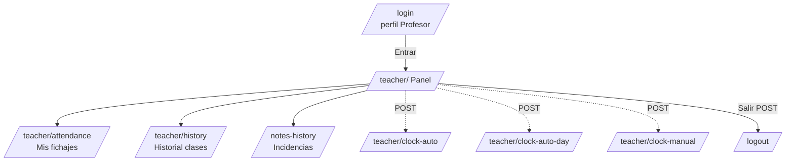

# Rutas y pantallas observadas

> Solo rutas vistas con permiso, perfil Profesor. **[HECHO]** = visitada/observada · **[HIPÓTESIS]** = inferida.
> No se listan datos de alumnos ni de otros empleados.

## 1. Rutas públicas (sin sesión)

| Ruta | Método | Pantalla / función |
|---|---|---|
| `/login` | GET | Acceso. Selector de perfil (Cliente / Profesor / Administrador); al elegir perfil aparece formulario **Usuario o correo + Contraseña + Entrar**. [HECHO] |
| `/portal/inscripcion` | GET | "Inscribirse" (alta). [HECHO] enlace |
| `/portal/recuperar` | GET | "Recuperar contraseña". [HECHO] enlace |
| `/` | GET | Raíz / landing ("Mi escuela"). [HIPÓTESIS] |

## 2. Rutas de Profesor (sesión requerida)

| Ruta | Método | Función |
|---|---|---|
| `/teacher/` | GET | **Panel Profesor**: recordatorios, fichaje de hoy, jornada, clases del día, fichajes de la semana, incidencias, resumen mensual. [HECHO] |
| `/teacher/attendance` | GET | **"Mis fichajes"**: resumen diario/mensual, tabla Fecha/Entrada/Salida/Horas, filtro por rango de fechas. [HECHO] |
| `/teacher/history` | GET | "Historial clases". [HECHO] enlace (no explorado a fondo) |
| `/notes-history` | GET | "Incidencias y comentarios" / "Ver histórico / editar". [HECHO] enlace |
| `/teacher/clock-auto` | POST | Fichaje automático de **hoy** (desde horario de clases). [HECHO] |
| `/teacher/clock-auto-day` | POST | Fichaje automático de **un día concreto** (`target_date`). [HECHO] |
| `/teacher/clock-manual` | POST | Fichaje **manual** (`day`, `start`, `end`). [HECHO] |
| `/filters/save` | POST | Guardar un filtro con nombre (`path`, `query_json`). [HECHO] genérico |
| `/logout` | POST | Cerrar sesión. [HECHO] |

## 3. Rutas de otros perfiles (fuera de alcance)

`Cliente` y `Administrador` existen como perfiles de login pero **no se exploran**: no son necesarios
para el fichaje y escapan a la autorización funcional de este proyecto.

## 4. Mapa de navegación (Profesor)

## 5. Pantallas clave para el fichaje

- **Panel `/teacher/`**: origen de las tres acciones de fichaje y del `csrf_token` que hay que leer
  antes de cada envío.
- **`/teacher/attendance`**: fuente de verdad del lado de la escuela para **conciliar** (tabla
  Entrada/Salida/Horas filtrable por `from_date`/`to_date`).
