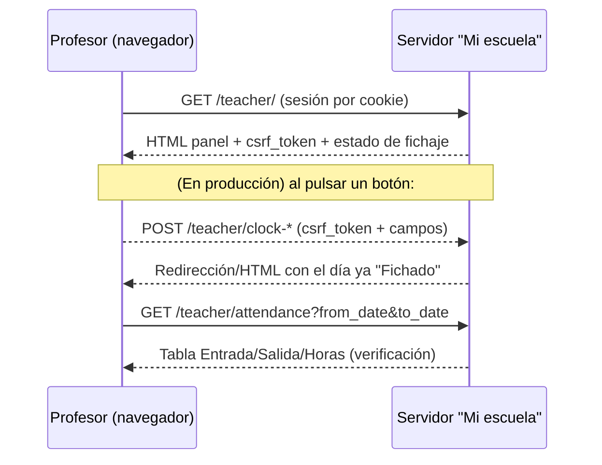

# Flujo técnico de fichaje

> Reconstruido **sin enviar ningún fichaje** (solo lectura del DOM y del HTML de los formularios).
> **[HECHO]** = observado · **[HIPÓTESIS]** = inferido, a confirmar con una prueba controlada autorizada.

## 1. Modelo de fichaje (importante)

**[HECHO]** El fichaje de esta plataforma **no es "entrada/salida en vivo"** (no hay un botón "fichar
ahora" que marque el instante actual). Es **por día**, con dos modalidades:

1. **Automático** — el servidor calcula las horas del día a partir del **horario de clases** del profesor.
   Los registros resultantes aparecen marcados como **`auto`** (ej.: Entrada `16:45:00 auto`, Salida
   `18:45:00 auto`, coincidiendo con las clases de ese día).
2. **Manual** — el profesor indica explícitamente `día`, `hora de entrada` y `hora de salida`.

**[HECHO]** Un día ya fichado muestra su botón **deshabilitado** ("Fichaje normal" en gris) → hay
**control de duplicados** (al menos en cliente; el servidor presumiblemente también lo valida → [HIPÓTESIS]).

## 2. Endpoints de fichaje

Todos son `POST` de formulario (`application/x-www-form-urlencoded`), requieren **sesión autenticada**
(cookie) y **`csrf_token`** (campo oculto, valor por sesión leído de la página).

### 2.1 `POST /teacher/clock-auto` — "Fichaje de hoy"
Campos: `csrf_token`.
Efecto [HIPÓTESIS]: registra el fichaje automático del día actual según el horario.

### 2.2 `POST /teacher/clock-auto-day` — "Fichaje normal" (un día)
Campos: `csrf_token`, `target_date` (p. ej. `2026-10-12`).
Efecto [HIPÓTESIS]: registra el fichaje automático de un día **pasado** concreto.

### 2.3 `POST /teacher/clock-manual` — "Guardar fichaje"
Campos: `csrf_token`, `day` (`type=date`, con atributo `max` = hoy), `start` (`type=time`), `end` (`type=time`).
Efecto [HIPÓTESIS]: registra/ajusta la jornada de `day` con entrada `start` y salida `end`.

> **[HECHO]** El input `day` trae `max="<hoy>"` → la UI no permite fichar en el **futuro**.
> Reglas de solapamiento, mínimos/máximos de horas o reescritura de un día ya fichado: **[HIPÓTESIS]**,
> a confirmar en una prueba controlada autorizada (no se han enviado datos).

## 3. Lectura del histórico (para verificación y conciliación)

**[HECHO]** `GET /teacher/attendance` devuelve:
- Tabla **Registros diarios**: `Fecha | Entrada | Salida | Horas` (días sin fichaje → `-  -  0.0`).
- **Horas por día** (semana) y **Total periodo**.
- **Resumen mensual** (h por mes).

**[HECHO]** Filtro por rango con **`from_date`** y **`to_date`** (formulario `GET` → query string).
**[HECHO]** **No** hay enlace de exportación (CSV/PDF) en esa pantalla → la lectura es por *scraping*
de la tabla HTML del rango solicitado.

## 4. Identificación del empleado

**[HECHO]** No se envía ningún identificador de empleado en los formularios de fichaje: el profesor se
deduce de la **sesión autenticada** (cookie). El nombre ("Nerea") se muestra en el panel pero no es un
parámetro de envío.

## 5. Hora: ¿servidor o dispositivo?

- **[HIPÓTESIS]** En modo **automático** las horas las pone el **servidor** a partir del horario (los
  valores vienen marcados `auto`).
- **[HECHO]** En modo **manual** las horas las aporta el **usuario** (`start`/`end`); el servidor las
  acepta/valida. La hora del dispositivo solo influye en el valor por defecto del input.

## 6. Secuencia observada (sin envío)

## 7. Estados y validaciones (parcial, a confirmar)

- **[HECHO]** Día ya fichado → botón deshabilitado (no re-fichar desde la UI).
- **[HECHO]** No se permite fichar en el futuro (`max` = hoy).
- **[HIPÓTESIS]** Respuestas de error (día inválido, solapamiento, fuera de plazo), formato de la
  respuesta (redirección 302 vs HTML con *flash message*): **no verificado**, requiere prueba autorizada.

## 8. Implicación para nuestra app

El concepto "Fichar entrada / Fichar salida en vivo" del brief debe **mapearse al modelo por día**:
nuestra app registra los eventos de la jornada en su propia BD y, para sincronizar, usa:
- `clock-auto` / `clock-auto-day` cuando basta el cálculo por horario, o
- `clock-manual` (`day`, `start`, `end`) cuando queremos fijar horas concretas.

La verificación del resultado se hace **releyendo** `/teacher/attendance` del día.
